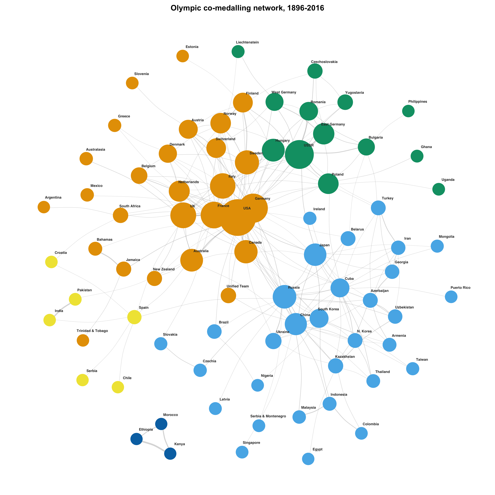

```{r}
#| include: false
source("/Users/edwardblaha/DataWrangling/Networks/Networks/Networks.R")
```
## Olympic Medal Network

The nodes in this network represent countries that have won medals at the Olympics. They are sized according to number of medals, and the edges represent appearing on the podium with other countries. Links are drawn when countries share a high weighted proportion of their medals with other countries rather than a high raw number to avoid over-plotting. Data was sourced from a publicly available compiled CSV. Geographically and politically linked nations often share similar Olympic histories. Large and highly successful IOCs like the US and China also share a lot, but they exist in different spheres. Countries like the US and Australia, which are geographically far apart but culturally similar, share a lot of podiums. Some unrelated nations are linked, likely because they happen to succeed in the same sports. 

```{r}
#| echo: false
#| fig-cap: "Olympic co-medalling network, 1896–2016"


```